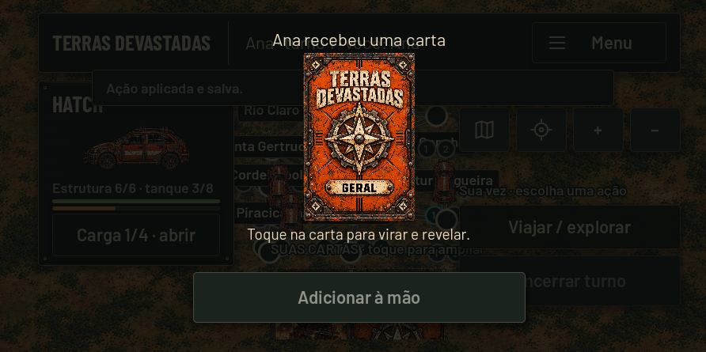
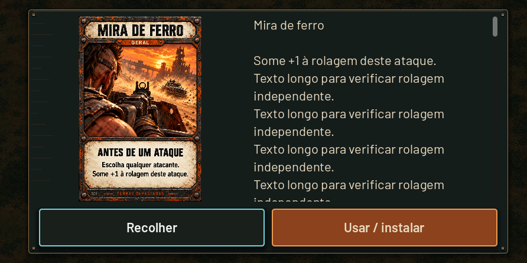
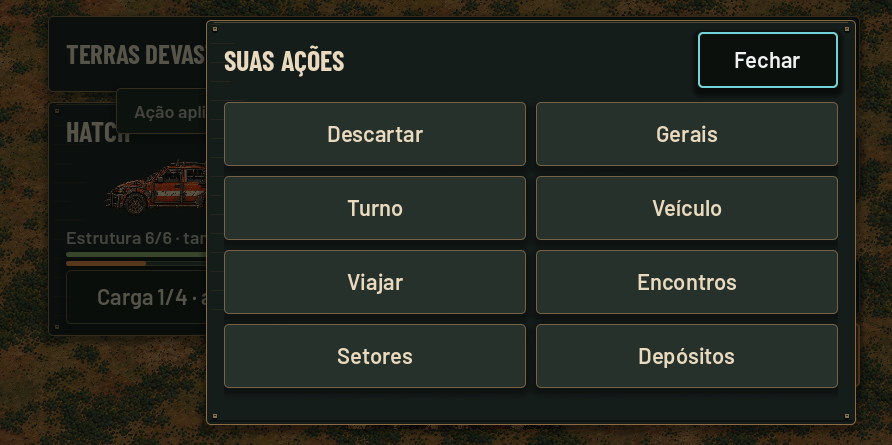

# Revisão do layout multiplayer LAN

31/10/2026 — base: feature/release-0.0.3, commit 398895ec.

## Relato e diagnóstico

O usuário informou que o painel escuro/estreito do print aparecia ao iniciar o turno. Sem logs do aparelho, não foi possível atribuir esse print a uma exceção específica nem reproduzir exatamente o painel vazio. A revisão encontrou e corrigiu problemas concretos de dimensões, camadas e retomada:

- A conexão impunha larguras mínimas de colunas maiores que sua área útil, sem limitar a altura do painel.
- As ações desativavam a rolagem mesmo quando textos, nomes ou conteúdos ultrapassavam a página.
- A consulta de cartas usava um diálogo de tamanho fixo, arte e texto sem área de leitura independente.
- A interrupção da virada não cancelava explicitamente a animação. O desbloqueio das informações privadas não reapresentava a carta pendente; sem nova alteração de estado, o jogador podia ficar bloqueado.
- Ferramentas do mapa e ações se sobrepunham em uma área lógica baixa; notificações eram desenhadas acima dos painéis de ações.
- Voltar no celular oferecia sair da sala mesmo com uma consulta aberta.

## Implementação

- `network/lan_layout.gd`: uma conversão de área segura física para coordenadas lógicas, compartilhada por conexão, HUD, cartas e prévia.
- Conexão/lobby: painel limitado à área útil, colunas adaptativas, formulário rolável quando necessário e rodapé Voltar separado. O teclado reduz o espaço usado e recolhe as colunas auxiliares.
- Ações: preservada a paginação de quatro opções, ou duas com combate; habilitada rolagem de reserva para conteúdo que exceder a altura. Fechar permanece fora da rolagem.
- `network/card_reader.gd`: arte proporcional, regras em região rolável e botões Recolher/Usar fora dessa região.
- Revelação: dimensões adaptativas e área segura; pausa cancela tweens e restaura a carta; desbloqueio reapresenta o ticket pendente. Nenhum comando de compra é repetido.
- HUD: ferramentas em linha em áreas baixas, etapas compactas e reserva superior do mapa ampliada. Notificações ficam abaixo das folhas.
- Voltar: fecha consulta, confirmação, prévia, folha ou carga antes de oferecer saída. A compra obrigatória mantém sua confirmação.

Regras, RNG, protocolo LAN, dados e formatos de save não foram alterados. O leitor e as folhas continuam exibindo somente a projeção autorizada do jogador.

## Verificação

Godot 4.7.2 Standard / Compatibility, renderização OpenGL real no Windows:

- `lan_mobile_layout.gd`: 40 verificações em cada formato — 892×445 com área lógica compacta, janela 1280×720 e janela 2340×1080 com recorte simulado.
- Cobertura: conexão, salas com nomes longos, teclado, IP manual, lobby com quatro jogadores, HUD, ausência de sobreposição de controles, início do turno pela UI, carta pendente, pausa no meio da virada, desbloqueio/revelação, coleta, ações, leitura longa, Voltar, carga e desconexão.
- `lan_ui_smoke.gd`: 30 verificações, zero falhas.
- `lan_session_smoke.gd`: 63 verificações, zero falhas.
- `lan_campaign_smoke.gd`: 197 verificações, zero falhas.
- `tv_remote_smoke.gd` e `reveal_smoke.gd`: zero falhas, incluindo a revelação animada no modo local.

Os perfis de teste ficaram isolados. O caminho muito longo do workspace virtual causou falhas de cache/driver OpenGL nos primeiros testes; repetir com perfis temporários curtos eliminou essas falhas sem alterar a configuração de renderização do jogo.

## Capturas

Capturas reais do formato compacto, não mockups:

## Validação que ainda falta

Gerar e instalar o novo APK no Android usado no relato. Confirmar início do turno, virada, pausa/retomada, área segura real, teclado e Voltar. Não foi gerado APK nesta revisão: SDK/JDK/templates Android não estão configurados neste ambiente. Windows, métricas simuladas e capturas não substituem essa confirmação.
