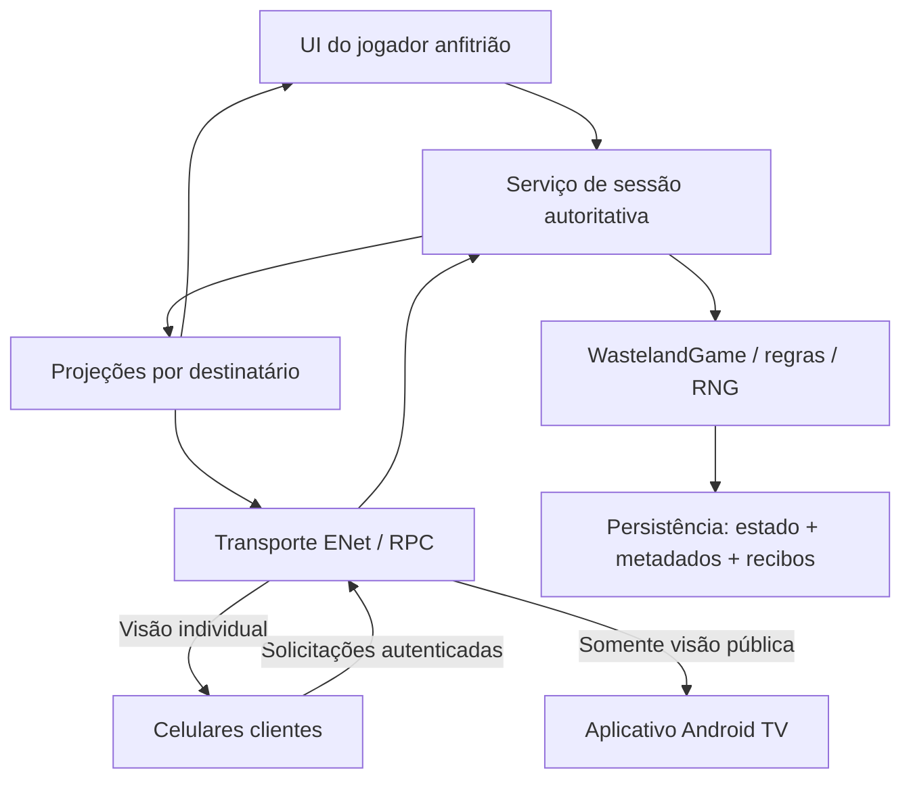

# Migração para multiplayer LAN e tabuleiro Android TV

**Projeto:** Terras Devastadas — runtime nativo em `godot/`.  
**Data:** 31/10/2026.  
**Base:** Godot 4.7 Standard, GDScript, renderer Compatibility; projeto documentado como validado no editor 4.7.2.  
**Estado:** planejamento detalhado, sem implementação de rede ou de TV neste trabalho.  
**Origem:** pedido do usuário, respostas sobre dispositivos e revisão técnica do plano nesta conversa.

Este documento orienta a evolução do modo local para uma sessão LAN de 2–4 jogadores, cada um em seu Android, acompanhada por um segundo aplicativo opcional para Android TV. As tarefas abaixo são propostas; suas caixas vazias não representam funcionalidades entregues. Criar este arquivo não autoriza iniciar a implementação.

## 1. Resultado esperado e decisões

### 1.1 Decisões confirmadas pelo usuário

| Decisão | Escolha confirmada |
| --- | --- |
| Dispositivos de jogo | Cada jogador usa seu próprio celular Android. |
| Quantidade de jogadores | Manter o suporte atual a 2–4 jogadores. |
| Conexão | Multiplayer em rede local, LAN. |
| Segundo aplicativo | Acompanha a partida como uma segunda tela compartilhada por todos. |
| Plataforma da segunda tela | Preferencialmente Android TV. |
| Participação da segunda tela | Somente consulta e apresentação; não executa ações da partida. |
| Dependência da TV | Opcional; o jogo funciona sem ela. |
| Escopo deste trabalho | Documentar a migração, sem implementar. |

### 1.2 Recomendações técnicas que compõem este plano

Estas escolhas foram propostas na revisão. São a base recomendada para execução futura, sem equivaler a requisitos de produto expressamente respondidos pelo usuário.

| Escolha | Motivo | Reavaliar quando |
| --- | --- | --- |
| Um celular de jogador hospeda a sessão | Permite jogar sem TV e sem servidor adicional. | For necessário hospedar em outro equipamento. |
| Anfitrião autoritativo e confiável | Reutiliza o motor centralizado e mantém uma fonte de verdade. | Houver requisito de proteção contra fraude do próprio anfitrião. |
| ENet e RPCs confiáveis | Integração com Godot e fluxo por turnos. | Outro runtime precisar consumir o protocolo. |
| Uma base Godot, dois pacotes Android | Compartilha apresentação do mapa, dados e protocolo. | O tamanho ou a manutenção dos pacotes justificar separação. |
| Preservar o modo hot-seat existente | Evita transformar a migração em substituição obrigatória do jogo local. | O usuário decidir retirar esse modo. |
| Fotografias completas da visão autorizada | Simplifica consistência e reconexão na primeira versão. | Medições apontarem custo de transmissão relevante. |
| Entrada manual por IP e descoberta automática posterior | Permite validar o transporte antes de adicionar descoberta. | A conexão direta estiver validada em aparelhos reais. |
| Uma TV conectada na primeira versão | Atende ao uso solicitado com limite verificável. | Forem solicitadas múltiplas telas públicas. |
| Sem novos jogadores após o início | Evita criar regras de entrada tardia. | Houver especificação de entrada durante a partida. |
| Sem limite automático de tempo para escolhas | Preserva as regras existentes. | O usuário aprovar regras de tempo/ausência. |

### 1.3 Fora da primeira entrega

- Partidas pela internet, contas, nuvem, matchmaking e servidor dedicado.
- Migração automática do anfitrião, hospedar pela TV e continuidade com o anfitrião encerrado.
- IA substituta, abandono com punição, passagem automática ou derrota por desconexão.
- Mistura de jogadores compartilhando um celular com outros jogadores remotos.
- Conversão de saves React ou exigência de paridade de seed com TypeScript.
- Espelhamento de tela por Cast/Miracast: a TV será um cliente do jogo com apresentação própria.
- Publicação nas lojas; preparar e testar pacotes não equivale a publicar.

## 2. Base atual e fontes de verdade

Ler [AGENTS.md](../AGENTS.md), [CONTEXT.md](../CONTEXT.md) e [README.md](../README.md) antes da execução. Os contratos são [rules.md](../../rules.md), [rules-cards.md](../../rules-cards.md), configurações e JSON relevantes. Conferir comportamento no código e nos testes nativos. O React em `src/` permanece referência e não prova implementação no Godot.

| Área atual | Consequência para a migração |
| --- | --- |
| `scripts/game_state.gd`, classe `WastelandGame`, deriva de `RefCounted` | O motor pode continuar independente da árvore; RPCs ficam em um `Node` separado. |
| `player()` retorna `state.players[state.active]` | Significa jogador ativo; não deve passar a significar silenciosamente jogador local. |
| Ordem de `state.players` é embaralhada no setup | Índice do array, ID do jogador e ID da conexão são identidades diferentes. |
| `act()` valida, restaura estado em recusa e tenta salvar | Preservar o resultado de regras e adaptar a fronteira de persistência para a sessão. |
| Falha de save é exposta por `persistence_error` | Ação aceita e gravação concluída são resultados diferentes. |
| `action_reason()` simula a validação no estado completo | Não disponibilizar o motor completo nos clientes apenas para habilitar botões. |
| `main.gd/dispatch()` chama o motor e lê o resultado imediatamente | Adaptar a UI para solicitações e respostas assíncronas. |
| `main.gd` salva e aplica passagem privada ao suspender | Separar ciclo de vida de anfitrião, cliente e hot-seat. |
| `board.gd` consulta motor, jogador ativo e legalidade de rotas | Extrair dados de apresentação; mapa da TV não deve depender do estado secreto. |
| Combate/campanha possuem decisões fora do turno | Autorizar pelo responsável da decisão, além de conferir o jogador ativo. |
| Instâncias de cartas e tickets de revelação já existem | Reutilizar as identidades; adaptar índices antigos na fronteira do motor. |
| Save local `campaign-native-v1.json`, schema `native-stage1`, versão 1 | Manter compatibilidade local e distinguir envelope de sessão LAN. |
| Preset com `permissions/internet=false`, somente ARM64 e target SDK sem valor explícito | Preparar permissões, fixar SDK de validação e conferir ABI dos aparelhos de TV. |

Limites funcionais atuais continuam valendo: V16 está sem efeito por decisão do usuário; E11 depende da fonte de sucata solta; restrições adicionais do alerta de saque e outras regras abertas não serão inventadas para completar o multiplayer. Presença de cartas ou artes não demonstra efeito implementado.

Há diferenças entre o estágio registrado nos documentos e possíveis artefatos no diretório, incluindo APK na raiz. A existência de um APK não comprova versão, instalação ou validação em aparelho. Registrar a build realmente usada em cada teste.

## 3. Arquitetura e propriedade dos dados



O anfitrião possui a única instância autoritativa do motor na sessão LAN. Clientes guardam cópias de apresentação das informações autorizadas. O celular anfitrião também utiliza uma projeção para renderizar sua UI; seu jogador passa pela mesma autorização dos demais, sem acesso privilegiado pelo fluxo de comandos.

### 3.1 Responsabilidades propostas

Os nomes são contratos de responsabilidade e sugestões de arquivos futuros, não classes já implementadas.

| Componente | Responsabilidade |
| --- | --- |
| `SessionService` | Interface de comandos, ciclo da sessão e adaptação local/LAN. |
| `SessionAuthority` | Fila serial de comandos, identidade do solicitante, autorização e aplicação no motor. |
| `NetworkEndpoint` | RPCs, conexão e envio direcionado; não contém regras de jogo. |
| `CommandPolicy` | Ações permitidas por papel, fase e dono da decisão. |
| `ViewProjector` | Constrói mensagens públicas e individuais por lista de campos permitidos. |
| `ClientViewStore` | Substitui a fotografia local por outra mais recente; emite mudanças para a UI. |
| `SessionStore` | Grava envelope autoritativo com estado, revisão e recibos associados. |
| `PublicEventPresenter` | Apresenta acontecimentos recebidos sem aplicar efeitos de regras. |
| `BoardPresentation` | Desenha mapa e peças a partir de dados de apresentação. |
| `LanDiscovery` | Anuncia e encontra salas, após validado o caminho por IP. |

### 3.2 Árvore de cenas de referência

```text
/root
├── NetworkEndpoint (Node, Autoload; mesmo caminho nos dois pacotes)
└── AppBootstrap (Node)
    ├── SessionService (Node)
    │   ├── SessionAuthority (Node; somente no anfitrião ou modo local)
    │   └── ClientViewStore (Node)
    └── InterfaceRoot (Control)
        ├── Lobby ou StartScreen (Control)
        └── PlayerScreen ou TvBoardScreen (Control)
            ├── BoardPresentation (Control)
            └── HUD e overlays adequados ao papel
```

O bootstrap seleciona celular/TV por configuração explícita do pacote, por exemplo uma feature customizada de exportação. Não presumir que criar dois presets altera automaticamente `run/main_scene`. Não alterar a cena principal compartilhada manualmente a cada exportação.

Se usar RPCs de alto nível, manter nomes, caminho e declarações RPC compatíveis no `NetworkEndpoint` dos dois aplicativos. O pacote da TV pode declarar a mesma interface de transporte e continuar sem permissão para ações. A autorização efetiva ocorre no anfitrião. [Referência Godot](https://docs.godotengine.org/en/4.7/tutorials/networking/high_level_multiplayer.html).

### 3.3 Alternativas consideradas

- **Servidor na TV:** tornaria o acessório parte da infraestrutura da partida; adiado para preservar sua participação opcional.
- **Servidor separado:** adiciona instalação e manutenção de equipamento; não é necessário para o primeiro objetivo LAN.
- **Motor e RNG executados em todos os aparelhos:** exige distribuir estado secreto e manter determinismo entre participantes; não atende à separação de informações proposta.
- **Atualizações parciais desde o início:** adicionam contratos de aplicação e recuperação antes de conhecer o custo real; avaliar após fotografias completas medidas.

## 4. Identidades, papéis e decisões

| Identidade | Significado e regra |
| --- | --- |
| `match_id` | Identifica a partida persistida, mesmo após reabrir o anfitrião. |
| `session_epoch` | Identifica a execução atual do serviço; muda ao reabrir/restaurar para invalidar mensagens antigas. |
| `player_id` | Identidade estável do jogador atribuída no setup; não é posição no array. |
| `peer_id` | Identidade transitória da conexão ENet; pode mudar ao reconectar. |
| `local_player_id` | Jogador associado ao celular atual; não muda ao passar o turno. |
| `active_player_id` | Jogador do turno, derivado da ordem de jogo. |
| `decision_id` | Ticket de uma escolha concreta ainda válida. |
| `decision_owner_id` | Jogador autorizado a responder àquela escolha. |
| `card_instance_id` | Cópia individual da carta; o ID do modelo não distingue cópias. |
| `command_id` | Identidade única de uma intenção enviada, preservada nos reenvios. |

Papéis da sessão: anfitrião, jogador conectado e espectador público. Papel administrativo de anfitrião não dá direito a jogar cartas ou escolher pelo adversário.

O servidor obtém o solicitante pela conexão validada. `player_id` enviado em argumentos é um alvo a conferir, nunca prova de identidade. Permitir somente uma conexão ativa por vaga de jogador; reconexão válida substitui a anterior e invalida o vínculo antigo.

Credenciais de reconexão são opacas, geradas com aleatoriedade apropriada, separada do RNG do jogo. Guardar a credencial no dispositivo correspondente e uma representação verificável no anfitrião; não publicá-la em logs, descoberta ou fotografias. A aprovação inicial da vaga acontece no anfitrião. Nome visível não autentica jogador.

### 4.1 Matriz inicial de autorização

| Família | Ator autorizado | Verificações adicionais |
| --- | --- | --- |
| `start`, `end`, `move`, `explore`, administração | Jogador ativo | Turno, ação, recursos, local e bloqueios do motor. |
| `conquer`, `duel` | Jogador ativo | Alvo e janela legal; iniciar encontro uma única vez. |
| `combatDefend`, `lootDefend` | Dono consultado para defesa | Ticket e fase de defesa pessoal. |
| `combatCard`, `raceGeneral`, `racePass`, `lootCard` | Responsável atual da reação | Ordem circular, cota, carta e alvo legais. |
| `raceEntry` | Jogador cuja inscrição está aberta | Uma resposta por jogador, combustível e elegibilidade. |
| `cardChoice` | Dono da escolha pendente | Ticket, opções e efeitos permitidos. |
| `acknowledgeCard` | Dono do ticket de revelação | Recebimento correto, inclusive fora do turno. |
| Descartes, tanque/carga e excedentes | Dono do recurso ou carta na janela legal | Não usar a exceção de excesso para administrar fora do turno. |
| `combatVehicleChoice` | Destinatário real da recuperação | Categoria, custo e escolha ainda pendente. |
| Rolagens e avanços de combate/corrida/saque | Responsável explícito indicado pela sessão | Conferir fase; animação e espectadores não avançam regras. |
| Repetição de save | Serviço autoritativo/anfitrião | Repete a escrita, sem reaplicar a ação. |
| Consulta pública e pedido de fotografia | Jogador ou espectador admitido | Projeção correspondente ao papel. |

Essa matriz é inicial. Na fase 0, enumerar todos os comandos reais de `game_state.gd`, `campaign_rules.gd`, `combat_rules.gd` e `world_rules.gd`; nenhum comando fica acessível por coincidência de prefixo ou pela ausência de uma regra de autorização.

Para os comandos de avanço que hoje dependem do aparelho compartilhado, recomendar como condutor o jogador que iniciou o encontro, com exceções explícitas para escolhas de outros donos. Conferir isso por fase e registrar antes da implementação, sem alterar custos, ordem ou oportunidades de reação.

## 5. Privacidade e projeções

### 5.1 Classificação inicial

| Informação | Público / TV | Dono | Anfitrião autoritativo |
| --- | --- | --- | --- |
| Grafo, cidades e apresentação das rotas | Sim | Sim | Sim |
| Nomes, cores, posição pública e controle territorial | Sim | Sim | Sim |
| Turno, fase pública, placar e resultado divulgado | Sim | Sim | Sim |
| Mão e reserva de cartas não públicas | Não | Sim, conforme revelação | Sim |
| Frente de carta adquirida ainda não virada | Não | UI mantém verso até a ação de revelar | Sim |
| Escolhas e opções privadas | Não | Somente as suas | Sim |
| Seed inicial, seed atual e ordem dos baralhos | Não | Não como jogador | Sim |
| `command_log`, argumentos internos e save completo | Não | Não como jogador | Sim |
| Tickets e IDs internos de cartas alheias | Não | Não | Sim |
| Credenciais de reconexão | Não | Somente a própria credencial | Dados de verificação |
| Carga, tanque, depósitos, equipamentos e hostis ainda não expostos | Conforme contrato a fechar | Conforme regras | Sim |

Auditar a última linha antes de liberar projeções de produção. Não transformar em informação pública algo que as regras não definem, nem esconder um dado necessário para uma ação legal. Se o saque permitir escolher recursos, a projeção deve oferecer apenas a consulta legitimamente necessária naquela janela.

A lista de ações disponíveis, os motivos de recusa e o nome do jogador aguardado também podem revelar informação. Não publicar existência/identidade de cartas elegíveis, opções secretas ou motivos baseados na mão adversária. A TV recebe uma descrição neutra da espera quando necessário.

### 5.2 Contrato de construção

1. Construir uma fotografia pública a partir de campos permitidos, sem copiar o save inteiro.
2. Construir a visão individual acrescentando somente dados autorizados ao jogador da conexão.
3. Gerar opções/ações legais no anfitrião; o cliente não usa `action_reason()` com estado secreto.
4. Direcionar a visão individual ao peer correspondente; nunca usar broadcast para dados privados.
5. Testar o conteúdo serializado, incluindo campos aninhados, mensagens de erro e histórico.
6. Manter o contrato atual de frente/verso também em tooltips e acessibilidade no celular dono.

O anfitrião conhece o estado completo; o modelo não protege contra adulteração do próprio servidor. Controle de destinatário também não equivale a criptografia de tráfego. A primeira entrega pressupõe rede local confiável; se for necessário sigilo contra captura da rede, acrescentar transporte protegido e pareamento autenticado como requisito específico antes da distribuição.

## 6. Protocolo de aplicação

### 6.1 Mensagens mínimas

| Mensagem proposta | Sentido | Conteúdo e propósito |
| --- | --- | --- |
| `hello` / `welcome` | Cliente ↔ anfitrião | Versões de protocolo/conteúdo, papel solicitado e compatibilidade. |
| `join_request` / `join_result` | Cliente ↔ anfitrião | Aprovação da vaga ou do espectador; credencial individual quando aplicável. |
| `lobby_view` | Anfitrião → admitidos | Jogadores, prontidão, vagas e telas públicas conectadas. |
| `command_request` | Jogador → anfitrião | Intenção identificada, argumentos e contexto esperado. |
| `command_result` | Anfitrião → solicitante | Aceite/recusa, revisão e condição de persistência. |
| `view_snapshot` | Anfitrião → destinatário | Fotografia completa da visão autorizada. |
| `presentation_events` | Anfitrião → destinatários autorizados | Acontecimentos identificados para apresentação. |
| `resume_request` / `resume_result` | Jogador ↔ anfitrião | Reconexão, nova epoch e reconciliação de intenções pendentes. |
| `command_status` | Jogador ↔ anfitrião | Consulta do recibo de um comando, sem executá-lo. |
| `resync_request` | Cliente/TV → anfitrião | Solicita fotografia atual sem alterar regras. |

### 6.2 Envelope de comando ilustrativo

Os nomes abaixo são propostos; a versão final deve ter validação de schema. O exemplo não é código de implementação.

```json
{
  "protocol_version": 1,
  "match_id": "partida-opaca",
  "session_epoch": "execucao-opaca",
  "command_id": "intencao-unica",
  "expected_revision": 42,
  "decision_id": null,
  "action": "move",
  "args": { "route": "id-real-validado-no-catalogo" }
}
```

A identidade do ator é obtida da sessão, não de um campo confiado ao cliente. Uma revisão monotônica aumenta a cada comando aceito que muda o estado. Save repetido, consulta e animação não criam uma nova revisão de regras.

### 6.3 Ordem de processamento

1. Verificar conexão admitida, limites da mensagem e tipos/formatos permitidos.
2. Conferir protocolo, partida, epoch e vínculo ao jogador.
3. Procurar recibo do mesmo `command_id` para aquele jogador/partida. Se houver, devolver o resultado conhecido; se o conteúdo divergir, recusar reutilização do ID.
4. Conferir revisão esperada, ticket de decisão e permissão do ator.
5. Resolver IDs estáveis para os índices atuais exigidos pelo motor legado.
6. Executar uma vez na fila serial autoritativa. A recusa preserva estado e RNG.
7. Associar revisão, recibo e acontecimentos ao resultado aceito; tentar a gravação conjunta.
8. Emitir resposta com persistência explícita e as fotografias direcionadas.

No primeiro protocolo, uma revisão desatualizada pode ser recusada conservadoramente. Atualizar a fotografia e pedir nova confirmação quando necessário. Não transformar uma intenção antiga em outra ação silenciosamente. `decision_id` distingue a escolha concreta; no futuro, pode permitir aceitar comandos independentes sem depender de igualdade de toda a revisão.

Um reenvio de transporte mantém ID e conteúdo. Uma nova decisão do usuário recebe outro ID. Não enfileirar ações para executar automaticamente quando o jogador reconectar.

### 6.4 Tipos, tamanho e versões

- Usar payloads de dados simples; não aceitar Objects, Resources, Callables, caminhos de scripts ou cenas enviados para execução.
- Validar profundidade, tamanho de strings, quantidade de elementos e frequência das solicitações.
- Não transmitir texturas pelo protocolo; enviar IDs que resolvem para assets locais.
- Separar versão de protocolo, schema do save e versões de regras/conteúdo/mapa.
- Na primeira entrega, aceitar somente builds explicitamente compatíveis; o mesmo número de protocolo não garante regras iguais.
- Normalizar IDs numéricos e coleções na serialização; uma rodada de codificação/decodificação não pode trocar inteiro por chave incompatível.

## 7. Sincronização e apresentação

A fotografia tem, no mínimo, `match_id`, `session_epoch`, `revision`, papel e dados da visão correspondente. Aceitar somente mensagens da autoridade esperada; ignorar fotografias antigas e rejeitar dados de outra partida/epoch fora do handshake de retomada.

Clientes substituem sua visão com a nova fotografia. Atualizam apenas os painéis afetados, preservando a orientação atual de evitar reconstrução de mão/inventário sem necessidade. Pode haver fotografias periódicas para recuperar apresentação, mas o motor não fica executando comandos por frame.

Acontecimento visual contém `event_id`, revisão e tipo, com payload filtrado. Por exemplo: viagem, resultado de exploração do dono, resultado público do dado e conquista. Deduplicar eventos por destinatário; ao reconectar, receber o estado atual sem reapresentar todo o histórico como novidade.

### 7.1 Fluxos que exigem cuidado

**Exploração:** o anfitrião calcula o delta entre estoque anterior e posterior após sucesso. Só o jogador autorizado recebe o detalhamento, conforme classificação. Abrir ou fechar popup nunca concede itens. Requisição repetida não cria outro resultado.

**Cartas:** `gain_card` permanece a entrada de aquisição; `take_hand_card` preserva a fila ao remover/transferir. Tickets de revelação sobrevivem à retomada. O cliente dono pode revelar as cartas iniciais na janela definida pela sessão; não exigir que todos virem ao mesmo tempo. Nenhum avanço ignora uma revelação obrigatória.

**Combate:** preservar a ordem circular de reações, limites por turno, arma adicional compartilhada, fuga, recompensa e recuperação de veículo. Somente o ator da decisão responde. A rolagem ocorre no motor uma vez; celulares e TV apresentam o mesmo valor recebido.

**Corridas e saque:** preservar inscrições, sequência de respostas, marcos, escolhas e retornos. Resolver excedentes do ganhador real, inclusive fora do turno. Não associar prêmio ao jogador ativo por conveniência da interface.

**Animações e consultas:** duração, fechamento de painel, câmera e movimento reduzido são locais. A TV não participa de barreiras de prontidão nem de confirmação. Para avanços existentes como `combatContinue` e `combatClose`, manter um ator definido; fim de Tween não equivale a comando coletivo.

## 8. Persistência, duplicação e retomada

### 8.1 Envelope de sessão proposto

```text
schema/version da sessão LAN
match_id + revisão persistida
versões de protocolo/regras/conteúdo/mapa
estado completo do motor, incluindo RNG e pendências
vagas associadas a player_id + verificadores de reconexão
recibos de comandos por jogador, com ID e conteúdo verificável
identificadores necessários para decisões e apresentação
```

Manter a partida local no formato existente. Usar arquivo/envelope distinto para LAN e preferências/credenciais locais separadas. A TV não recebe nem grava o save completo; no máximo guarda preferências de apresentação e endereço recente, sem segredos dos jogadores.

O registro `command_log` atual é auditoria do motor, não um recibo de rede. Ele registra o jogador ativo e seeds internas; precisa permanecer privado. O envelope deve registrar também o ator autenticado das decisões fora do turno, sem mudar o significado de registros legados silenciosamente.

### 8.2 Fronteira única de gravação

Hoje `act()` já faz a escrita final e `save_game()` suprime escritas internas durante um comando. Para LAN, introduzir uma fronteira/adaptador de persistência que grave estado e metadados da sessão juntos. Não fazer duas gravações independentes, uma para efeitos e outra para deduplicação.

Preservar a estratégia de temporário/renomeação e conferir erros, recuperação e backup em Android. Validar todos os campos antes de substituir a sessão em memória. Não alterar RNG durante migração estrutural.

### 8.3 Ação aplicada e ação salva

| Situação | Resposta e comportamento |
| --- | --- |
| Comando recusado | Sem mudança de regras ou RNG; motivo filtrado para o solicitante. |
| Aplicado e gravado | Recibo e estado persistidos juntos; confirmação com revisão salva. |
| Aplicado com falha de gravação | Estado em memória permanece aceito; resposta informa salvamento pendente. |
| Reenvio conhecido durante a mesma execução | Devolve o recibo; não reaplica efeito nem sorteia. |
| Anfitrião encerrado após save válido | Reabre o último envelope válido, preservando recibos e pendências. |
| Anfitrião encerrado após falha de save | Pode perder o trecho não gravado; não prometer recuperar a revisão mostrada pelos clientes. |

Recomendação para LAN: após falha de gravação, bloquear novos comandos que alteram a partida até a recuperação da escrita. Manter consulta, reconexão e tentativa de salvar. Isso limita o período não durável; não desfaz a ação já aceita nem a executa de novo. O modo local preserva seu contrato atual, salvo mudança específica aprovada.

No primeiro escopo, guardar os recibos aceitos durante toda a partida. Medir crescimento junto ao histórico. Qualquer compactação futura precisa manter uma barreira que impeça reexecutar IDs antigos; eliminar recibos por tempo sem outra proteção é incorreto.

### 8.4 Reconexão

1. Cliente reconhece a perda, bloqueia novas ações e conserva somente intenções pendentes para consulta.
2. Faz handshake e comprova a vaga com a credencial correspondente.
3. Anfitrião reassocia o novo peer ao mesmo `player_id`; conexão antiga deixa de atuar.
4. Entrega epoch atual, fotografia individual e situação dos comandos pendentes.
5. Cliente reconcilia pela revisão autoritativa e consulta recibos sem reenviar ações antigas automaticamente.
6. Se o anfitrião reiniciou, mensagens da epoch anterior não são executadas. Um recibo durável pode ser consultado após o novo handshake; ausência de recibo exige reconciliação, não repetição cega.

Reconectar não cria novo jogador, nova mão, nova seed ou nova rolagem. A TV segue fluxo público equivalente, sem credencial de jogador e sem restaurar comandos.

Saves hot-seat existentes não são convertidos automaticamente em LAN. A primeira versão pode exigir nova partida LAN; importação explícita de uma partida nativa fica adiada até haver contrato de atribuição das vagas e de compatibilidade.

## 9. Sala, rede e ciclo de vida Android

### 9.1 Fluxo proposto

1. Celular anfitrião escolhe **Criar partida LAN**; define nome da sala e número de jogadores.
2. A interface mostra endereço e porta; os demais usam **Entrar em partida LAN**.
3. Anfitrião aprova jogadores e, separadamente, a tela pública.
4. Cada jogador confirma prontidão; só então o anfitrião executa o setup uma vez e salva.
5. Depois do início, vagas não são cedidas a pessoas novas; reconexões continuam permitidas.
6. TV pode entrar e sair durante a partida; não ocupa uma vaga de jogador nem precisa estar pronta para iniciar.

Um anfitrião que também joga precisa atender pelo menos três celulares remotos e uma TV: quatro conexões remotas admitidas. Configurar capacidade e limites do lobby de acordo, sem confundir quantidade de peers e quantidade de jogadores.

### 9.2 Transporte e descoberta

Recomendação inicial: uma porta UDP configurada no projeto, com erro claro para conflito, indisponibilidade e timeout. Usar ENet confiável para comandos, respostas e estado. Não assumir que entrega confiável mantém recibos após nova conexão.

Implementar conexão manual antes da descoberta. Na etapa de descoberta, escolher anúncio UDP ou integração NSD/mDNS depois de validar suporte/permissões do SDK e da TV escolhidos. Manter a entrada por IP como alternativa; descoberta pode falhar mesmo quando unicast funciona.

Wi-Fi/Ethernet precisam permitir comunicação entre dispositivos; o mesmo nome de Wi-Fi não garante isso. Validar também TV por cabo e celulares por Wi-Fi. Hotspot de celular deve ter cenário próprio de teste; não declarar suporte universal sem evidência. Não adicionar UPnP, redirecionamento externo de portas ou servidor de internet para atender a LAN.

### 9.3 Interrupções

| Ocorrência | Política inicial proposta |
| --- | --- |
| Jogador sem decisão atual desconecta | Mostrar ausência; pode continuar até surgir uma decisão obrigatória dele. |
| Jogador responsável por uma escolha desconecta | Manter a escolha pendente e aguardar reconexão; não usar ou passar carta automaticamente. |
| TV desconecta/suspende | Partida continua; TV marca estado desatualizado e pede fotografia ao voltar. |
| Anfitrião suspende ou perde rede | Demais aparelhos entram em espera/reconexão; nenhuma autoridade alternativa assume. |
| Processo do anfitrião termina | Reabrir o app e continuar o último save LAN válido, com nova epoch. |
| Anfitrião decide encerrar a sessão | Informar os participantes e preservar save; distinguir encerrar conexão de abandonar/apagar partida. |

Tratar `NOTIFICATION_APPLICATION_PAUSED` e retomada de forma distinta por papel. Não aplicar a tela hot-seat de “sou o próximo jogador” ao cliente de identidade fixa. Manter ocultação local de informação privada quando necessário ao suspender.

Durante sessão hospedada ativa, recomendar manter tela ligada enquanto o app estiver em primeiro plano e informar que suspender pode interromper a conexão. Não depender de execução indefinida em segundo plano; serviço Android em foreground fica fora do primeiro escopo.

### 9.4 Permissões e exportação

- Habilitar `INTERNET` nos pacotes que usam LAN; ela é necessária mesmo sem servidor na internet. [Godot](https://docs.godotengine.org/en/4.7/tutorials/networking/high_level_multiplayer.html).
- Registrar SDK alvo e versão Android testados. Para Android 17 com alvo SDK 37+, tratar `ACCESS_LOCAL_NETWORK` em tempo de execução ou uma alternativa mediada compatível. Não presumir que somente `INTERNET` basta. Para alvos anteriores, seguir a orientação específica da plataforma. [Android](https://developer.android.com/privacy-and-security/local-network-permission).
- Verificar como os templates/plugins Godot da versão escolhida expõem as permissões necessárias; incluir adaptação Gradle/plugin somente se a prova técnica demonstrar necessidade.
- Tratar concessão, negação e revogação; não ficar reconectando indefinidamente por falta de permissão.
- Não solicitar câmera, localização ou Bluetooth por padrão; descoberta e pareamento escolhidos devem justificar suas próprias permissões.
- Manter dados JSON, mapa, assets usados e licenças nos pacotes; excluir testes, ferramentas e documentos do runtime conforme configuração existente.

## 10. Aplicativo Android TV

### 10.1 Conteúdo e apresentação

Mapa como elemento principal, sem copiar a interface de celular ampliada. A composição deve conter:

- Tabuleiro com cidades, rotas, veículos e setores públicos, identificados por nome/número além de cor.
- Turno, jogador ativo e descrição pública da situação.
- Resumo público de cada jogador, placar e anúncio territorial quando aplicável.
- Destaques breves de movimento, combate, conquista, corrida e vitória.
- Estado de conexão com indicação explícita quando o mapa estiver desatualizado.

Enquadramento padrão mostra o mapa inteiro; a câmera é independente dos celulares. Destaques podem aproximar uma região e retornar à visão geral. Não exigir que todos mantenham a mesma câmera. Oferecer opção de movimento reduzido na TV.

Corridas e confrontos podem usar um painel público dedicado, mantendo acesso à visão geral. Não preencher espaço com valores internos ainda não classificados como públicos.

### 10.2 Controle remoto

Todo o fluxo precisa funcionar com direções, confirmar e voltar: escolher sala, preencher IP com teclado adequado, aceitar conexão, consultar cidade/setor, controlar visão e sair. Foco visível, ordem previsível e retorno ao elemento anterior ao fechar modal.

Não depender de toque, pinça, hover, mouse, câmera ou QR lido pela TV. Zoom/arrasto do celular precisam de equivalentes acessíveis pelo controle. Um QR futuro pode ajudar o celular, mas não é dependência da primeira versão.

### 10.3 Pacote e dispositivo

- Identificador Android próprio e identidade visual de aplicativo Tabuleiro.
- Manifest com entrada `LEANBACK_LAUNCHER`, declaração apropriada de suporte TV e touchscreen não obrigatório.
- Ícone/banner e navegação legíveis à distância; conferir bordas e área útil em TV física.
- ABI compatível com a TV escolhida; não assumir que o preset ARM64 atual cobre aparelhos com sistema de 32 bits.
- Usar Compatibility como base e medir memória, importação de texturas e desempenho no hardware alvo.
- Produzir primeiro APK instalável para testes; distribuição assinada e publicação são etapas próprias.

Esses requisitos de plataforma devem ser conferidos novamente na execução. [Guia oficial Android TV](https://developer.android.com/training/tv/get-started/create).

## 11. Sinais e fluxo de dados propostos

Os sinais abaixo descrevem comunicação interna; não são uma API já existente.

| Sinal | Origem → consumidor | Payload mínimo | Efeito |
| --- | --- | --- | --- |
| `connection_changed` | Transporte → sessão/UI | Papel, estado e motivo público | Atualiza lobby, espera e reconexão. |
| `command_requested` | UI → sessão | ID, ação, argumentos, contexto | Encaminha para validação local ou remota. |
| `command_resolved` | Sessão → UI solicitante | ID, aceite/recusa, revisão, persistência | Libera solicitação pendente e mostra feedback. |
| `view_changed` | ViewStore → painéis/mapa | Revisão e áreas alteradas | Renderiza a fotografia autorizada. |
| `decision_changed` | ViewStore → UI dona | Ticket, tipo e opções permitidas | Abre ou encerra a escolha correta. |
| `presentation_received` | Sessão → apresentação | Evento autorizado e identificado | Anima ou notifica sem modificar regras. |
| `persistence_changed` | SessionStore → sessão/UI | Revisão salva e condição de escrita | Sinaliza pendência e bloqueia avanço quando necessário. |

Fluxo de uma viagem:

1. Jogador seleciona uma rota e vê prévia local; isso não consome RNG nem ação.
2. Confirma a viagem; UI gera uma intenção e mostra solicitação pendente.
3. Sessão envia ao anfitrião ou chama o mesmo serviço local se for o aparelho anfitrião.
4. Autoridade confere identidade, revisão e legalidade; motor paga combustível e resolve os efeitos uma vez.
5. Persistência associa estado, revisão e recibo; o serviço constrói as visões autorizadas.
6. Cada cliente recebe sua fotografia. A TV recebe apenas a pública.
7. Apresentações animam a viagem. Uma escolha decorrente do evento abre somente para seu dono; demais telas mostram espera pública adequada.

## 12. Plano de execução por fases

Cada fase termina com evidências e regressão pertinentes. Não adiar toda a reconexão para depois de migrar a campanha. Os arquivos citados como novos são sugestões; registrar os caminhos efetivos ao implementar.

### Fase 0 — inventário e contratos

**Dependência:** nenhuma implementação de rede.  
**Objetivo:** fechar as fronteiras que evitam exposição de dados e ações atribuídas ao jogador errado.

- [ ] Inventariar todas as chamadas ao motor, mutações de estado, RNG e gravação nos scripts de UI.
- [ ] Enumerar comandos reais com ator, alvo, fase, argumentos e pendências que bloqueiam a execução.
- [ ] Completar a classificação de informação pública/privada, incluindo carga, tanque, depósitos, hostis, equipamentos e logs.
- [ ] Definir o responsável pelos avanços de cada fase de combate, corrida e saque.
- [ ] Documentar schemas das mensagens, versões e política de revisão/ticket.
- [ ] Definir limites de payload, peers e operações pendentes com valores testáveis.
- [ ] Identificar celulares e TV disponíveis, Android/ABI, rede de teste e SDK de exportação.
- [ ] Registrar o baseline dos saves/testes locais sem alterar os arquivos reais do usuário.

**Entregas:** catálogo de comandos, classificação de dados e contratos de protocolo.  
**Skills para execução:** `godot-brainstorming`, `multiplayer-basics`, `save-load`, `godot-code-review`.  
**Saída:** nenhum campo de produção ou comando acessível fica com privacidade/ator indefinido. Contratos divergentes das regras são resolvidos ou mantidos fora da migração.

### Fase 1 — prova técnica LAN e Android TV

**Dependência:** contrato mínimo da fase 0; pode usar dados sintéticos para não expor uma partida real.  
**Objetivo:** provar conexão, privacidade direcionada e execução na TV antes de uma refatoração extensa.

- [ ] Criar um endpoint comum e uma tela mínima de conexão por IP/porta.
- [ ] Conectar um anfitrião, um celular cliente e a TV com papel público.
- [ ] Testar retorno de erro ao criar servidor/cliente e todos os sinais de conexão relevantes.
- [ ] Enviar um campo público aos dois clientes e um campo privado apenas ao celular dono.
- [ ] Inspecionar payloads recebidos pela TV; ausência visual não basta como teste de privacidade.
- [ ] Bloquear tentativa de comando de jogo vinda da TV no anfitrião.
- [ ] Validar instalação, launcher e foco/controle remoto na TV física.
- [ ] Testar negação de permissão, desconexão e suspensão do anfitrião.

**Entregas:** prova técnica isolada e relatório dos aparelhos, builds e mensagens.  
**Skills para execução:** `multiplayer-basics`, `mobile-development`, `export-pipeline`, `input-handling`, `godot-ui`.  
**Saída:** conexão real entre os três dispositivos e verificação positiva de separação de dados. Uma prova com mensagens sintéticas ainda não significa partida multiplayer.

### Fase 2 — serviço de sessão e adaptação da interface

**Dependência:** fases 0 e 1.  
**Objetivo:** remover a associação implícita entre aparelho atual e jogador do turno.

- [ ] Criar a fachada de sessão com adaptadores local, anfitrião e cliente.
- [ ] Preservar `WastelandGame.player()` como jogador ativo ou renomear seus usos explicitamente; não trocar sua semântica de forma silenciosa.
- [ ] Introduzir identidade local e responsável pela decisão nas interfaces de apresentação.
- [ ] Adaptar `main.gd/dispatch()` para solicitar e consumir respostas, sem assumir resultado imediato.
- [ ] Impedir que cliques em sequência criem intenções duplicadas enquanto uma solicitação está pendente.
- [ ] Migrar mão, carga, veículo, escolhas e combate para dados da visão autorizada.
- [ ] Extrair a entrada de apresentação do mapa das consultas ao motor completo.
- [ ] Separar passagem hot-seat dos bloqueios/retomada de uma identidade fixa LAN.
- [ ] Manter o caminho de execução local testável com os mesmos contratos de comando.

**Entregas:** serviço de sessão, ViewStore, adaptação de painéis e mapa.  
**Skills para execução:** `component-system`, `gdscript-patterns`, `godot-ui`, `hud-system`, `2d-essentials`.  
**Saída:** partida local continua funcionando; um jogador cliente mantém sua própria mão e resumo durante turnos adversários, sem possuir o save completo.

### Fase 3 — autoridade, persistência e recuperação básica

**Dependência:** fase 2.  
**Objetivo:** aplicar cada intenção uma vez e recuperar a sessão sem reexecutar comandos antigos.

- [ ] Implementar fila serial e autorização por ator/fase, inclusive para o anfitrião jogador.
- [ ] Adicionar `command_id`, revisão, `decision_id`, vínculo de peer e `session_epoch`.
- [ ] Resolver instâncias de cartas para índices somente após conferir posse e contexto.
- [ ] Implementar projeções por campos permitidos e fotografias completas.
- [ ] Introduzir fronteira de gravação conjunta de estado da partida e recibos.
- [ ] Preservar o modo local e saves antigos; definir envelope LAN e backup próprios.
- [ ] Reconectar na mesma vaga e consultar comandos pendentes sem reaplicação automática.
- [ ] Tratar save pendente, recuperação de escrita e rollback ao último save válido após encerramento.
- [ ] Adicionar testes de falha nos limites entre aplicação, gravação e envio da resposta.

**Entregas:** contratos executáveis de sessão e retomada básica.  
**Skills para execução:** `multiplayer-basics`, `save-load`, `gdscript-patterns`, `godot-testing`.  
**Saída:** reenvio, resposta perdida, reconexão e reabertura do anfitrião não duplicam efeitos já persistidos. Falhas de persistência exibem seus limites reais.

### Fase 4 — lobby e ciclo principal jogável

**Dependência:** fase 3.  
**Objetivo:** uma partida LAN com setup, turno e operações principais, sem atalho de autoridade.

- [ ] Criar/entrar, aprovação de vagas, nomes, prontidão e verificação de versões.
- [ ] Executar setup no anfitrião uma única vez; associar IDs após embaralhar ordem dos turnos.
- [ ] Entregar cartas iniciais somente aos donos e preservar tickets de revelação.
- [ ] Migrar início/fim, compra, viagem e exploração.
- [ ] Migrar depósito/carga/tanque, reparos, administração e instalações nas janelas legais.
- [ ] Adaptar notificações e delta de exploração para respostas/eventos direcionados.
- [ ] Verificar anúncio territorial, confirmação de vitória e eliminação com IDs estáveis.
- [ ] Fazer a TV mínima acompanhar posições, donos e turno a partir da fotografia pública.

**Entregas:** ciclo LAN principal entre 2–4 jogadores com tabuleiro mínimo opcional.  
**Skills para execução:** `multiplayer-basics`, `godot-ui`, `inventory-system`, `hud-system`, `godot-testing`.  
**Saída:** mesmos comandos legais produzem resultados compatíveis com o motor local, preservando RNG e regras. Sistemas ainda não migrados são identificados e não declarados prontos.

### Fase 5 — encontros e decisões fora do turno

**Dependência:** fase 4 e autorização completa por fase.  
**Objetivo:** cobrir os fluxos de maior risco de atribuição e travamento.

- [ ] Conquista, duelo, defesa pessoal e continuidade contra fortificação na mesma ação.
- [ ] Reações de combate/fuga na ordem correta, inclusive cartas ainda pendentes de revelação.
- [ ] Rolagens, arma fixa, ataque adicional e limites de equipamento.
- [ ] Saque, cartas, defesa, retirada e alerta conforme contrato atual.
- [ ] Eventos e escolhas persistentes; preservar V16 sem efeito.
- [ ] Corrida: inscrições, reações, marcos, surpresa, avanço e premiação.
- [ ] Recompensa ao vencedor real, carta transferida, recuperação de veículo e excedentes fora do turno.
- [ ] Mortes, Hatch de retorno, perda do próximo turno e eliminação.
- [ ] Reconexão de cada dono durante decisões, revelações e recompensas pendentes.
- [ ] Confirmar que animações locais e TV desconectada não bloqueiam regras.

**Entregas:** campanha funcional em rede nos sistemas nativos já implementados.  
**Skills para execução:** `multiplayer-basics`, `state-machine`, `inventory-system`, `godot-ui`, `save-load`, `godot-testing`.  
**Saída:** partida completa pode terminar pelos critérios implementados; decisões não são atribuídas ao jogador ativo por engano.

### Fase 6 — aplicativo Tabuleiro definitivo

**Dependência:** prova física da fase 1, apresentação pública estável das fases 4–5.  
**Objetivo:** uma segunda tela utilizável à distância, independente das interfaces privadas.

- [ ] Bootstrap e pacote separados com identidade própria e endpoint compatível.
- [ ] Tela de conexão, lista de sala ou IP e aprovação pública sem ocupar vaga.
- [ ] Visão geral das 12 cidades, 35 setores e rotas dos dados atuais.
- [ ] Resumo público dos jogadores, turno, placar e destaques de acontecimentos.
- [ ] Consulta de cidades/setores, combate e corrida públicos conforme relevância.
- [ ] Navegação completa por controle, foco, Voltar e recentralização.
- [ ] Câmera independente e movimento reduzido; fotografias antigas não restauram animações antigas.
- [ ] Tratamento de desligamento, perda de rede e retorno com estado atualizado.
- [ ] Ajuste de ABI, manifest, ícone/banner, bordas e legibilidade em TV física.

**Entregas:** APK Tabuleiro testável e relatório visual/funcional.  
**Skills para execução:** `godot-ui`, `hud-system`, `responsive-ui`, `input-handling`, `2d-essentials`, `mobile-development`, `export-pipeline`.  
**Saída:** iniciar, conectar, acompanhar, consultar e sair somente pelo controle remoto; zero dados privados recebidos pela TV.

### Fase 7 — descoberta e estabilidade em aparelhos

**Dependência:** conexão direta e sessão completa já funcionais.  
**Objetivo:** reduzir atrito de conexão e consolidar o comportamento em rede real.

- [ ] Implementar anúncio/descoberta com a estratégia escolhida e permissões verificadas.
- [ ] Manter alternativa por IP e mensagens que distinguem permissão, timeout e incompatibilidade.
- [ ] Validar Wi-Fi, Ethernet/Wi-Fi, IP alterado, roteador reiniciado e redes com isolamento.
- [ ] Testar suspensão, retomada e encerramento de processo por papel.
- [ ] Revisar crescimento de save/histórico/recibos, tamanho das fotografias e consumo de memória.
- [ ] Medir latência entre confirmar ação e apresentar revisão nos dispositivos; registrar ambiente e limites observados.
- [ ] Limitar repetições de conexão e tempestades de pedidos sem perder a possibilidade de tentar novamente.

**Entregas:** conexão cotidiana e relatório de estabilidade/desempenho.  
**Skills para execução:** `multiplayer-basics`, `mobile-development`, `godot-optimization`, `export-pipeline`, `godot-debugging`.  
**Saída:** descoberta funciona nos ambientes declarados; limitações de outras redes são documentadas e conexão direta continua disponível.

### Fase 8 — homologação e documentação

**Dependência:** fases anteriores.  
**Objetivo:** demonstrar a entrega sem confundir código, teste desktop e Android físico.

- [ ] Executar regressão local e a matriz LAN/TV das seções seguintes.
- [ ] Registrar build, commit quando disponível, aparelho, Android, ABI, SDK, rede e resultado de cada cenário.
- [ ] Inspecionar payloads públicos/individuais e conferir ausência de segredos nos logs dos clientes.
- [ ] Gerar pacotes reproduzíveis, guardar identificação de versão e instruções de instalação/teste.
- [ ] Atualizar `CONTEXT.md`, README e relatórios de UI com estados realmente entregues.
- [ ] Registrar limitações de anfitrião, compatibilidade, saves e permissões.
- [ ] Manter publicação e distribuição externa como tarefas separadas.

**Entregas:** relatório de homologação, APKs identificados e documentação atualizada.  
**Skills para execução:** `godot-testing`, `godot-code-review`, `mobile-development`, `export-pipeline`.  
**Saída:** critérios da seção 15 atendidos com evidência; nenhuma funcionalidade recebe status de Android físico apenas por teste Windows.

## 13. Estratégia de testes

### 13.1 Regressão nativa existente

Usar o perfil isolado do README, com APPDATA/LOCALAPPDATA no workspace e saves temporários dedicados. Não reutilizar a partida real do usuário. Adaptar testes de UI quando a fachada mudar sem apagar as verificações de regras, RNG e privacidade para fazê-los passar.

| Grupo | Scripts existentes relevantes |
| --- | --- |
| Regras e contratos | `smoke.gd`, `data_validation.gd`, `shared_contracts.gd` |
| Campanha e casos extremos | `campaign_smoke.gd`, `campaign_edges.gd` |
| Combate e recompensa | `combat_smoke.gd`, `pvp_rewards.gd` |
| Inventário e exploração | `transfers_smoke.gd`, `exploration_ui_smoke.gd` |
| Privacidade e apresentação | `reveal_smoke.gd`, `combat_ui_smoke.gd`, `campaign_ui_smoke.gd` |
| Entrada e layout | `start_screen_ui_smoke.gd`, `onboarding_ui_smoke.gd`, `mobile_layout_smoke.gd`, `modern_ui_smoke.gd`, `ui_smoke.gd` |

Escolher o conjunto pertinente por fase e executar a regressão integrada antes da homologação. Nenhum teste foi executado como parte da criação deste plano; os nomes acima foram conferidos no diretório atual.

### 13.2 Testes novos necessários

| Grupo | Cenário | Invariante |
| --- | --- | --- |
| Projeção | Gerar público, jogador A e jogador B | Cada payload tem apenas campos autorizados; não há seeds, baralhos ou logs internos. |
| Identidade | Embaralhar ordem e trocar turno | Mão/veículo locais permanecem no dono correto. |
| Autorização | Cliente envia `player_id` alheio | Recusa sem efeito e sem consumo de RNG. |
| Espectador | TV chama comando de jogo | Recusa no servidor, mesmo com UI adulterada. |
| Duplicação | Mesmo ID/conteúdo enviado duas vezes | Uma aplicação; segundo resultado é o recibo. |
| Reutilização de ID | Mesmo ID, argumentos diferentes | Recusa explícita. |
| Concorrência | Dois pedidos no mesmo contexto | Execução serial; o segundo é revalidado, nunca aplicado sobre estado antigo. |
| Ticket | Resposta a reação já encerrada | Recusa sem usar outra carta ou responder outra decisão. |
| Instância | Duas cópias iguais e mudança de índices | Executa somente a cópia e o dono selecionados. |
| Reconexão | Peer muda, vaga permanece | Mesmo jogador, mão e pendências; peer anterior deixa de agir. |
| Persistência | Encerrar após gravar e antes de responder | Recibo sobrevive; reconsulta não duplica efeito. |
| Falha de escrita | Aplicar ação e falhar save | Ação fica aceita em memória; repetir save não repete RNG. |
| Estado recuperado | Restaurar save anterior ao trecho não gravado | Nova epoch e reconciliação explícita; clientes não impõem estado antigo. |
| Save inválido | Envelope truncado/incompatível | Sessão válida em memória/backup não é substituída silenciosamente. |
| Apresentação | Evento repetido ou fotografia antiga | Sem recurso duplicado nem notificação antiga como novidade. |
| Versões | Regras/conteúdo incompatíveis | Conexão de jogo recusada antes do setup. |
| Serialização | IDs e números após codificação | Identidades, quantidades e RNG preservados. |
| Limites | Payload excessivo/tipo inesperado | Rejeição controlada, sem carregar recursos nem encerrar a sessão. |

Comparações de regressão podem executar uma sequência de comandos no motor local e pela autoridade LAN usando o mesmo estado inicial. Comparar efeitos e RNG autoritativos; não exigir igualdade de credenciais, IDs de transporte ou animações.

### 13.3 Matriz mínima em Android físico

Todas as linhas começam como **pendentes**. Um teste com emulador/Windows ajuda a diagnosticar, mas não fecha uma linha física.

| ID | Configuração/cenário | Resultado esperado | Estado |
| --- | --- | --- | --- |
| A01 | 2 celulares, sem TV, Wi-Fi sem internet | Setup e partida LAN funcionam. | Pendente |
| A02 | 4 celulares e 1 TV | Vagas corretas e TV fora da contagem de jogadores. | Pendente |
| A03 | TV entra após vários turnos | Estado público atual, sem histórico animado integral. | Pendente |
| A04 | TV sai durante combate/corrida | Decisões e avanço dos jogadores continuam. | Pendente |
| A05 | Jogador não ativo usa reação | Pedido chega ao dono, na ordem legal, sem revelar sua mão aos demais. | Pendente |
| A06 | Compra/revelação interrompida | Mesmo ticket/carta na retomada; sem recompra. | Pendente |
| A07 | Exploração com toque duplo e resposta perdida | Uma ação e um ganho no depósito. | Pendente |
| A08 | PvP, saque e excedente fora do turno | Recompensa e escolha pertencem ao vencedor real. | Pendente |
| A09 | Suspender/reabrir celular cliente | Mesmo jogador e fotografia atual. | Pendente |
| A10 | Suspender/reabrir anfitrião | Espera identificada e retomada conforme estado salvo. | Pendente |
| A11 | Encerrar processo anfitrião após ação persistida | Reabre sem executar a ação novamente. | Pendente |
| A12 | TV Ethernet e celulares Wi-Fi | Comunicação se a rede permitir tráfego entre ambos. | Pendente |
| A13 | Rede com isolamento entre clientes | Erro de conexão compreensível; sem criação de nova partida. | Pendente |
| A14 | Android/SDK com permissão LAN negada/revogada | Recuperação orientada e ausência de espera infinita. | Pendente |
| A15 | Controle remoto do início ao fim | Conectar, consultar, voltar e sair sem toque/mouse. | Pendente |
| A16 | Retomar durante combate, corrida e escolha de prêmio | Sem travamento por dono ausente nem novo sorteio. | Pendente |
| A17 | Anfitrião e cliente em versões incompatíveis | Recusa antes de compartilhar partida. | Pendente |
| A18 | Partida até vitória territorial e outra até sobrevivência | Encerramentos consistentes em todas as telas. | Pendente |
| A19 | Sessão prolongada com vários ciclos de reconexão | Sem crescimento descontrolado de UI/conexões e sem desvio de estado. | Pendente |
| A20 | Inspeção do payload da TV e adversário | Ausência de mãos, seeds, escolhas e credenciais alheias. | Pendente |

Hotspot, diferentes modelos de TV e diferentes versões Android entram na matriz conforme disponibilidade. Declarar exatamente quais combinações foram testadas; não generalizar a partir de um único aparelho.

## 14. Riscos e decisões pendentes

| Risco | Tratamento planejado |
| --- | --- |
| UI assume jogador ativo em todos os painéis | Identidade local explícita e testes com ordem embaralhada. |
| Comando fora do turno executado por pessoa errada | Matriz de autorização e tickets por decisão. |
| Nova propriedade secreta vaza em snapshot | Construção por lista permitida e inspeção automatizada do payload. |
| Estado salvo e recibo não correspondem | Envelope único e testes com interrupção entre etapas. |
| Cliente fica preso aguardando evento visual | Estado autoritativo recuperável e eventos sem efeitos de regras. |
| Suspensão Android derruba o anfitrião | Save, espera/reconexão e limite explícito de execução em primeiro plano. |
| TV não instala ou aparece no launcher | Prova física no início, manifest e ABI verificados. |
| Descoberta falha por rede/permissões | Conexão manual preservada e diagnóstico separado. |
| Migração altera regras abertas | Contratos atuais preservados e limitações registradas. |
| Refatoração quebra hot-seat/saves | Adaptador local, arquivos separados e regressão desde a fase 2. |

Antes de executar a fase correspondente, registrar as respostas técnicas e de produto ainda necessárias:

1. Classificação definitiva de carga, tanque, depósitos, hostis não revelados e detalhes de equipamento.
2. Condutor autorizado de cada avanço do encontro, respeitando os comandos e escolhas existentes.
3. Dispositivo Android TV de referência, ABI, versões Android e SDK alvo de homologação.
4. Estratégia de descoberta e necessidade real de integração nativa para permissões/manifest.
5. Valores medidos/aceitáveis para tamanho de mensagem, save, latência e duração do teste prolongado.
6. Necessidade futura de sigilo contra captura da rede ou proteção contra anfitrião adulterado.

Esses itens não impedem documentar nem fazer uma prova isolada com dados sintéticos. Classificação e autorização devem estar resolvidas antes de conectar uma partida real aos clientes.

## 15. Critérios finais de conclusão

- [ ] 2–4 pessoas jogam cada uma no próprio Android, com um celular anfitrião.
- [ ] Uma TV opcional acompanha a sessão em qualquer momento, recebendo somente informação pública.
- [ ] Celulares mantêm mão e decisões individuais, inclusive fora do turno.
- [ ] Somente o anfitrião executa regras/RNG; seu jogador não contorna autorização.
- [ ] Reenvios e reconexões não duplicam efeitos persistidos; falha de save é comunicada com precisão.
- [ ] Combate, eventos, corridas, saque, excedentes e vitórias implementados no nativo funcionam na rede.
- [ ] TV desconectada ou animação lenta não bloqueia a partida.
- [ ] Reiniciar o anfitrião permite retomar o último save válido sem criar jogador, compra ou rolagem extra.
- [ ] Modo hot-seat, saves e preferências existentes permanecem utilizáveis.
- [ ] Dois APKs identificados foram instalados e testados nos aparelhos declarados.
- [ ] Testes físicos, limites conhecidos e versões estão registrados na documentação.

O primeiro marco demonstrável é: **dois celulares e uma TV conectados; uma viagem aceita pelo anfitrião; mapa público atualizado; e um dado privado entregue somente ao dono**. A conclusão da migração exige também a recuperação e a campanha completa; o marco inicial prova apenas essas capacidades delimitadas.

## 16. Orientação para quem executar o plano

1. Ler instruções e contexto atuais do repositório novamente; este documento registra a base de 31/10/2026.
2. Iniciar pela primeira fase sem evidência de conclusão; não tratar caixas vazias como trabalho já realizado.
3. Ler as skills indicadas antes de implementar cada domínio. Elas não autorizam regras novas, dependências ou publicação fora do escopo.
4. Manter regras no motor; não resolver inconsistência de rede ajustando dano, recompensas ou RNG na UI.
5. Trabalhar por entregas verificáveis; atualizar este plano com caminhos reais, evidências e decisões revisitadas.
6. Atualizar README/CONTEXT apenas conforme o estado implementado mudar, distinguindo planejado, implementado, testado em desktop e validado em Android físico.
7. Não sobrescrever saves reais nem modificar assets originais, caches `.godot/` ou a referência React para acomodar a rede sem necessidade específica.

### Referências do projeto

- [Instruções nativas](../AGENTS.md), [contexto](../CONTEXT.md) e [execução/testes](../README.md).
- [Regras](../../rules.md) e [catálogo de cartas](../../rules-cards.md).
- [Planejamento visual](../../update_ui.md) e [estado da UI](UI_IMPLEMENTATION.md).
- [Campanha implementada](CAMPAIGN_IMPLEMENTATION.md), [recompensas PvP/Moto](PVP_REWARDS_AND_MOTO.md) e [mapa v3](MAP_ALIGNMENT_V3.md).

### Referências técnicas consultadas em 31/10/2026

- [Godot 4.7: multiplayer de alto nível](https://docs.godotengine.org/en/4.7/tutorials/networking/high_level_multiplayer.html).
- [Android: permissão de rede local](https://developer.android.com/privacy-and-security/local-network-permission).
- [Android TV: criação e configuração do aplicativo](https://developer.android.com/training/tv/get-started/create).

As referências técnicas podem mudar. Conferir versões de editor, templates, SDK e documentação ao iniciar a implementação.

