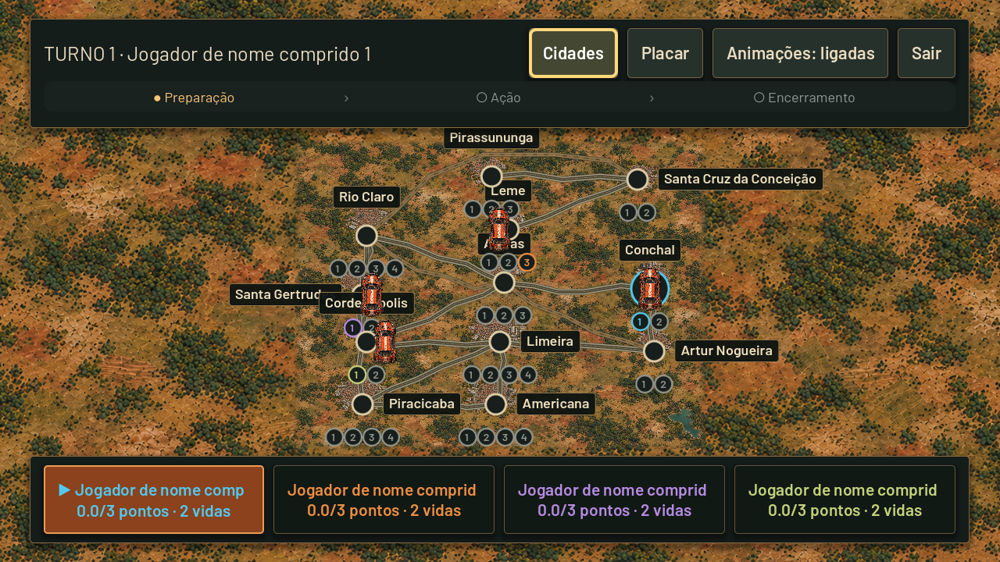
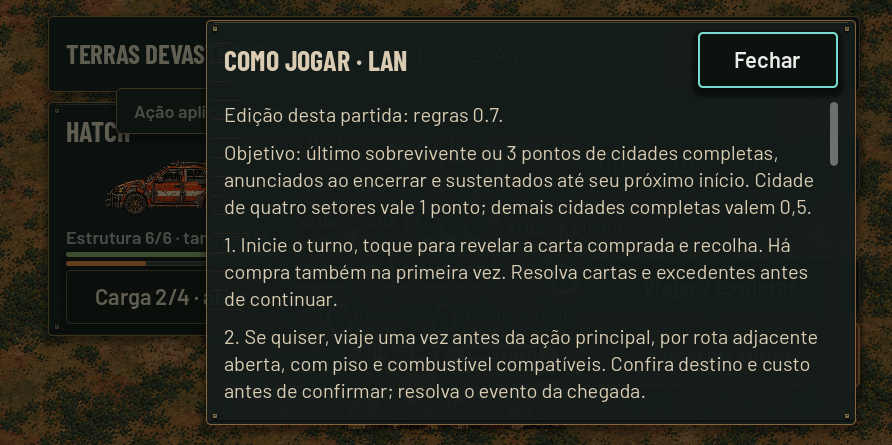

# Interação, animações e Tabuleiro TV

Atualização da branch `feature/release-0.0.4`, mantendo regras 0.7 e saves antigos. As mudanças são de apresentação; não criam novas ações nem dependência de confirmação da TV.

## Botões e leitura

- `ui_feedback.gd` conecta toque, hover e foco dos botões existentes. Anima a cor, sem redimensionar controles, trocar callbacks ou alterar custo/elegibilidade.
- O feedback genérico exclui a árvore de compra/revelação. A animação de carta aprovada pelo usuário permanece.
- Grupos LAN de viagem/setores/carga têm ícones existentes; ações de turno/dado/avanço recebem destaque. Ações agressivas mantêm texto/custo e confirmação, com estilo de perigo.
- Dicas descrevem depósito versus carga, custos e limites. Contadores próprios na LAN realçam mudanças sem reconstruir inventário.
- A ajuda local e LAN usa o mesmo texto por edição em `how_to_play.gd`. A folha LAN mantém rolagem, Fechar fixo e Voltar contextual.

## Tabuleiro TV

`network/tv_dashboard.gd` troca a antiga lista lateral por mapa integral e uma camada pública:

- Topo com jogador/turno e os mesmos passos `turn_steps.gd`: Preparação, Ação e Encerramento.
- Placar compacto permanente na base com todos os jogadores, pontos/objetivo e vidas; seta do ativo e estrela do anúncio. Nomes longos são recortados no cartão, com nome completo nos detalhes.
- Controle remoto/toque pode abrir cidade, placar e cartão de jogador; somente informações públicas são exibidas. Detalhes de encontro aceitam foco e rolagem ↑/↓; nas extremidades, o controle pode sair para outros botões. Não envia comandos de jogador.
- Combate mostra estrutura/defesa/dano e último dado resolvido. Corrida mostra progresso real; barras interpolam a mudança sem sortear resultados.
- Faixa breve destaca ações públicas e mudança de turno. Desconexão mantém o placar com aviso de dados desatualizados; reconexão limpa o aviso.
- Movimento reduzido pode ser alternado no próprio topo e é persistido nas preferências do aparelho. Os dados continuam visíveis sem movimento.

## Efeitos e privacidade

`board_feedback.gd` guarda somente nome/posição/modelo/integridade/vidas e dono dos setores. Compara fatos públicos aceitos e desenha destaques curtos de dano/reparo, veículo, conquista e vez. Nunca lê mãos, estoque, baralho ou RNG. Mantém no máximo seis efeitos, um por cidade, e não processa quando ocioso.

Primeiro snapshot, partida/epoch nova e recuo de revisão estabelecem baseline sem efeitos. Snapshot repetido não repete animação. Movimento reduzido e desconexão limpam os efeitos. Viajar usa a animação de rota existente; não foi duplicada a simulação de deslocamento.

## Verificação

- `tv_dashboard_smoke.gd`: quatro nomes longos, geometria em 1280×720/1920×1080, etapas/placar, consulta pública, estado/RNG preservados, efeitos de dano, repetição de snapshot, encontro, movimento reduzido, nova epoch e desconexão/reconexão.
- `lan_mobile_layout.gd`: inclui ajuda rolável/Fechar/Voltar nas três resoluções de celular, além da compra e novas ações 0.7.
- Runner inclui `tv_dashboard_smoke`; regressões de controle remoto, compra/revelação, abertura local e LAN permanecem necessárias.

Validação em Godot 4.7.2/Windows: **13 suítes de interface aprovadas**, incluindo compra/revelação, combate, campanha, introdução, tela inicial, celular normal/texto ampliado, LAN em três resoluções e controle remoto. O dashboard TV passou em **47 verificações**; cada resolução LAN passou em **54 verificações**, incluindo ajuda com rolagem, Fechar e Voltar. A inspeção das capturas levou também a uma guarda contra botões comprimidos em faixas verticais no topo da TV. Navegação e efeitos preservaram estado/RNG, capacidades e privacidade nos cenários testados.

Capturas em `.tools/tv-dashboard-1280.png`, `tv-dashboard-1920.png`, `tv-damage-feedback.png`, `tv-encounter.png` e `lan-help-mobile-*.png`. Desktop não comprova Android/TV físicos ou conforto à distância.

## Exportação

O workflow prepara as variantes de teste de celular e TV. A TV usa Gradle e o template Android source da mesma versão: a opção de launcher Android TV exige Gradle no [exportador oficial Godot 4.7.2](https://github.com/godotengine/godot/blob/4.7.2-stable/platform/android/export/export_plugin.cpp). SDK/NDK/JDK seguem o [config.gradle oficial](https://github.com/godotengine/godot/blob/4.7.2-stable/platform/android/java/app/config.gradle). A verificação do pacote TV inclui launcher leanback, assinatura, ARM64 e INTERNET. Só considerar o APK entregue após a execução CI concluir com sucesso.

## Capturas verificadas

TV com nomes longos, foco visível, etapas do turno e placar persistente:

Ajuda LAN em 892×445, com texto rolável e Fechar acessível:

